<div align="center">



<br>
<br>

**どのMacで目を覚ましても、いつもの机に帰ってこられるように。**

<sub>kaito5757 の開発環境を、1行で。<br>新しいMacにはまるごと。使い込んだMacには、違うところだけを確かめながら。</sub>

<br>
<br>


<br>
<br>


</div>

<br>

## 01 · はじめる

ターミナルに、この1行を。新しいMacでも、使い込んだMacでも同じです。git や Homebrew がまだなくても構いません。

```bash
curl -fsSL https://raw.githubusercontent.com/kaito5757/dotfiles/main/install.sh | bash
```

dotfiles そのものに手を入れたいときは、clone してから。何度実行しても、同じところに落ち着きます。

```bash
gh repo clone kaito5757/dotfiles ~/dev/personal/kaito5757/dotfiles
```

```bash
cd ~/dev/personal/kaito5757/dotfiles && ./setup.sh
```

> [!NOTE]
> 迷ったときは Enter。いつも、何も壊さないほうが選ばれます。

## 02 · ひらくと起きること

どの手順も、まず全体を一覧で見せて、違うところだけを尋ねます。黙って上書きすることはありません。

| | 手順 | |
|:-:|---|---|
| `1` | Homebrew | なければ公式のインストーラーで迎え入れ、Brewfile の足りない分だけを入れる |
| `2` | 設定ファイル | dotfiles からコピーする。同じなら何もせず、違えば差分を見せて相談する |
| `3` | mise | node や python などの道具を揃える |
| `4` | macOS と Loop | キーリピート、トラックパッド、Dock、Caps Lock、Loop のショートカットを揃える |
| `5` | アプリ | OrbStack を起こし、Loop の権限の画面を開き、最後に Ghostty へ |

長い処理は静かにスピナーだけを回し、細かな出力は `~/.local/state/dotfiles/logs/` に残します。終わりには、次にやること（ログアウトや各アプリへのログイン）をまとめて置いていきます。

## 03 · この机にあるもの

| | |
|---|---|
| シェル | zsh · [Starship](https://starship.rs) · fzf · zoxide · autosuggestions · syntax-highlighting |
| ターミナル | [Ghostty](https://ghostty.org) — Catppuccin Mocha · JetBrains Mono Nerd Font · カーソルが尾を引くシェーダー |
| 言語と道具 | [mise](https://mise.jdx.dev) で node · python · bun · pnpm |
| コマンド | gh · supabase · gum · gitleaks |
| アプリ | Cursor · OrbStack · TablePlus · Loop · Slack · Discord |
| macOS | 速めのキーリピート · タップでクリック · 右に隠れる Dock · Caps Lock を Control に |

## 04 · 違いに出会ったら

使い込んだMacの設定は、そのMacの歴史です。違いが見つかると、こう尋ねます。

```text
◆  どうしますか？
│    1  既存の設定を残す
│    2  dotfilesで置き換える（バックアップあり）
│    3  1か所ずつ選んで統合する
│    4  ターミナルで差分を表示
│    5  今回はスキップ
```

`3` を選べば、Git の競合を解くように、違う箇所ごとに「このMac」「dotfiles」「両方」から選べます。置き換える前には必ず `~/.local/state/dotfiles/backups/<日時>/` に控えを残します。

## 05 · 秘密のこと

公開しているリポジトリなので、トークンやパスワードは三つの場所で守っています。

- **コミットのとき** — [gitleaks](https://github.com/gitleaks/gitleaks) が中身を確かめ、見つけたら止める（clone 後に一度 `./setup.sh` を実行すると有効になる）
- **push のとき** — GitHub の push protection が、既知の形のトークンを受け取らない
- **画面に映すとき** — 差分にトークンらしき値があれば `[伏せ字]` にして表示する（ファイルの中身はそのまま）

Macごとの秘密は、`~/.zshrc.local` のようにリポジトリの外へ。

<br>

<details>
<summary><b>06 · 手を入れる</b></summary>

### 設定ファイルを増やす

1. ファイルをリポジトリに置く（例：`git/.gitconfig`）
2. `setup.sh` の `CONFIGS` に `git/.gitconfig|.gitconfig` を1行足す
3. `./setup.sh` で「最新です」と出るのを確かめてからコミット

アプリは `Brewfile` に、言語や道具は `mise/config.toml` に。

### macOS の設定を変える

`macos/defaults.txt` を1行1項目で。今の値は `defaults read <domain> <key>`、型は `defaults read-type <domain> <key>` で確かめられます。

```text
NSGlobalDomain|KeyRepeat|float|2|キーリピートの速度（小さいほど速い）
```

### Loop の設定を持ち帰る

Loop の画面で設定を変えたら、これを実行してからコミット。管理している項目だけを取り込みます。

```bash
./scripts/export-loop.sh
```

### MacBook と Mac Studio で変えたいとき

コピーで配っているので、各Macで直接書き換えて構いません。次の `./setup.sh` で「既存の設定を残す」を選べば、そのまま残ります。毎回尋ねられたくない部分は、別のファイルに分けて読み込みます。

```bash
# ~/.zshrc（dotfiles 側）の末尾
[ -f ~/.zshrc.local ] && source ~/.zshrc.local
```

Ghostty なら `config-file = ?local.config`（`?` を付けると、ファイルがなくても止まらない）。

</details>

<details>
<summary><b>07 · 困ったとき</b></summary>

### 控えから戻す

```bash
ls ~/.local/state/dotfiles/backups/
```

```bash
cp -p ~/.local/state/dotfiles/backups/<日時>/.config/ghostty/config ~/.config/ghostty/config
```

シンボリックリンクだったものは、`cp` ではなく `mv` で戻します。

### 何が起きたかを見る

細かな出力は `~/.local/state/dotfiles/logs/<日時>.log` に。失敗したときは、その最後の部分が画面にも出ます。

### Caps Lock を元に戻す

```bash
launchctl bootout gui/$(id -u)/local.dotfiles.capslock-to-control
```

```bash
rm ~/Library/LaunchAgents/local.dotfiles.capslock-to-control.plist
```

```bash
hidutil property --set '{"UserKeyMapping":[]}'
```

### そのほか

- **途中でやめたい** — Ctrl-C で。置き換えは一時ファイルからの `mv` なので、書きかけのファイルは残りません。
- **シンボリックリンクがあった** — 勝手には上書きしません。置き換えるのはリンクだけで、リンク先には触れません。
- **色を消したい** — `NO_COLOR=1 ./setup.sh`
- **矢印キーで選びたい** — gum（Brewfile に入っています）があれば、自然とそうなります。

</details>

<details>
<summary><b>08 · 構成</b></summary>

```text
dotfiles/
├── install.sh            # curl | bash 用。一時フォルダに落として setup.sh を実行
├── setup.sh              # 5つの手順の本体
├── Brewfile              # アプリとコマンド
├── scripts/
│   ├── install-config.sh # 表示・質問・コピー・統合
│   ├── apply-defaults.sh # macOS と Loop の設定
│   └── export-loop.sh    # Loop の設定を dotfiles に取り込む
├── macos/                # defaults.txt · loop.plist · Caps Lock 用の LaunchAgent
├── zsh/                  # .zprofile · .zshrc
├── ghostty/              # config · shaders/cursor_smear.glsl
├── starship/             # starship.toml
├── mise/                 # config.toml
├── docs/                 # README の絵
└── .githooks/pre-commit  # gitleaks
```

</details>

<br>

<div align="center">

<br>
<sub>kaito5757 · since 2026</sub>
</div>
